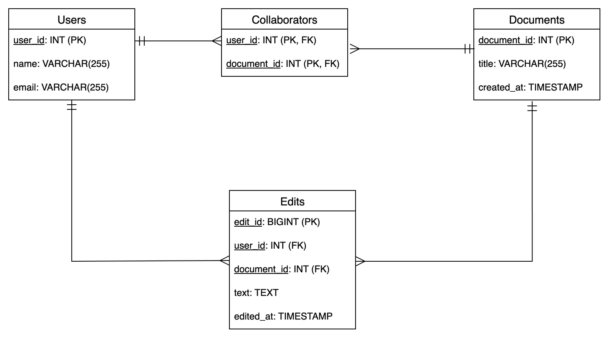

# mongodb-nosql-assignment

## Setup

# Bring up docker container

```
docker run -d --name mongodb -p 27017:27017 mongo:8.0

```
### Scripts:
>  ``` ./setup-database.sh ```

### find a documern 
>  ``` ./find-document.sh ```

### Manual usage
> 1. Create database "big-data-assignment"
> 2. Create a collection documents
> 3. Import "big-data-assignment.documents.json" file by clicking "add data"
> 4. Create a collection users
> 5. Import "big-data-assignment.users.json" file by clicking "add data button"

In order to query a document , open mongo shell and search a dccument by id


```
db["documents"].find({_id: ObjectId('6ae8942c9dc83bd3cdf6141a')})

```

SQL Schema vs MongoDB collection design

SQL Schema design 


MongoDB Collection design


